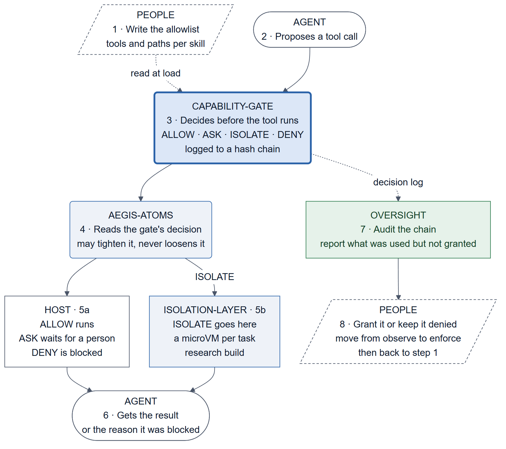

# Landen Stecker

**Security architect for AI agents**

CISSP &nbsp;&middot;&nbsp; M.S. Artificial Intelligence candidate, Santa Clara University
&nbsp;&middot;&nbsp; Navy veteran

> **The helpfulness is the hazard.** A capable agent without context or bounds does not
> refuse. It fills the gap with a guess and acts, with real permissions.

So the control cannot live inside the model. I build the control that sits in front of
every action an AI agent takes, and answers three questions: who allowed this action, how
do we stop it now, and how do we prove what happened.

## Three repos, one system

**[capability-gate][cg]** decides each tool call before it runs. Deny by default, a kill
switch, and each decision on a hash-chained log before the answer goes back to the agent.
[One command][demo] shows it working, and 34 checks each delete one control and confirm a
test catches it. It checks tool names and paths, not shell command text.
[![OpenSSF bestpractices.dev: capability-gate][bp-badge]][bp]
[![capability-gate DOI][doi-badge]][doi]

**[aegis-atoms][atoms]** holds small policy facts and a judge that may tighten a verdict,
never loosen it. Built and tested; not measured live.

**[isolation-layer][il]** runs a risky task in its own Firecracker microVM under the
jailer. Research build. Jailed boots on a separate KVM test host are logged in its
[receipts][il-receipts]; CI runs a stand-in VM. Wiring the gate's isolate route to the
real box is the next step.

**Research.** [owasp-dual-top10-lab][dual] maps the OWASP Top 10 for LLM and agentic apps
to MITRE ATLAS techniques, CVEs and AI incidents. [newwave-owasp-security-lab][nw] is
the earlier course lab.

## How I work

- Controls ship with a test that fails when the control is removed.
- Observe before enforce: watch real traffic, then write the policy.
- The limit sits next to the claim.
- Independent review before anything merges.

## Background

Nearly seven years of Navy security operations across Bahrain, Poland and Norfolk.
Built the security program for a NATO installation from construction to commissioning.
Led a fifty-person security department at Naval Station Norfolk as Security Operations
Manager (billet: Watch Commander).

M.S. Artificial Intelligence at Santa Clara University, in progress. B.S. Cybersecurity
Technology. CISSP, ISC2 CC, CompTIA Security+ and A+.

Earlier work

**[cpt-reimbursement-engine][cpt].** A dependency-free TypeScript engine that predicts
where Medicare reimbursement fails, not just whether a code exists.

**[crypto-signal-confluence][csc].** A research instrument that tests whether fusing
volume, sentiment and technical signals holds up under purged cross-validation and
realistic costs. Edge on real data is unproven.

[bp-badge]: https://www.bestpractices.dev/projects/16124/badge
[bp]: https://www.bestpractices.dev/projects/16124
[doi-badge]: https://zenodo.org/badge/DOI/10.5281/zenodo.22018052.svg
[doi]: https://doi.org/10.5281/zenodo.22018052
[cg]: https://github.com/Steck43/capability-gate
[demo]: https://github.com/Steck43/capability-gate#see-it-work
[atoms]: https://github.com/Steck43/aegis-atoms
[il]: https://github.com/Steck43/isolation-layer
[il-receipts]: https://github.com/Steck43/isolation-layer/blob/main/receipts/STEP-12b-2026-10-09.md
[dual]: https://github.com/Steck43/owasp-dual-top10-lab
[nw]: https://github.com/Steck43/newwave-owasp-security-lab
[cpt]: https://github.com/Steck43/cpt-reimbursement-engine
[csc]: https://github.com/Steck43/crypto-signal-confluence
